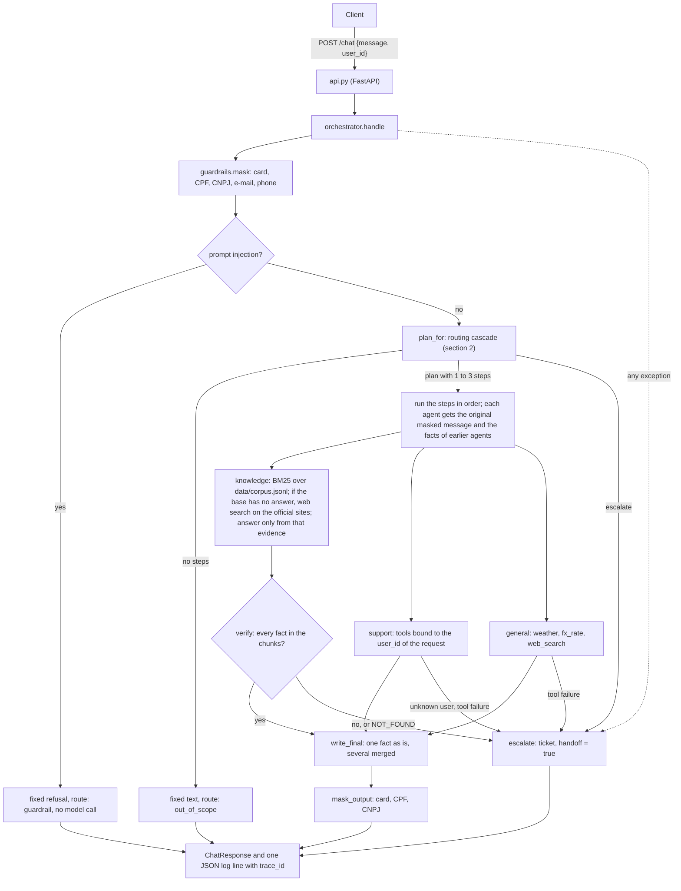
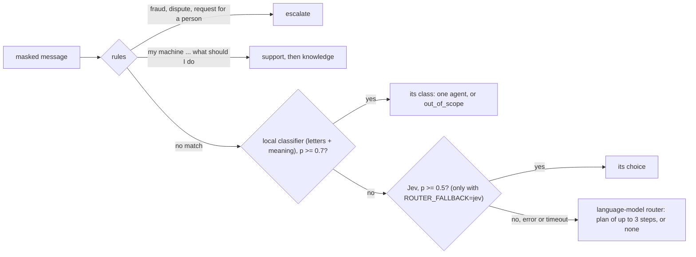

# Architecture

Diagrams of what the code does today. Text versions and the reasons behind each choice are in `README.md` (sections 3 and 4) and in `specs/plan.md` (decisions D01 to D22).

## 1. One request, end to end

## 2. Routing cascade, cheapest step first

`decided_by` in the response names the step that decided: `rule`, `clf`, `jev` or `llm`.

## 3. Components and what they talk to

| Component | File | Talks to |
|---|---|---|
| HTTP API | `src/app/api.py` | `orchestrator.handle` |
| Orchestrator and router | `src/app/orchestrator.py`, `router_clf.py`, `jev.py` | the agents; Jev over HTTPS (optional) |
| Agents | `src/app/agents.py` | the model gateway, the retriever, the tools |
| Model gateway | `src/app/llm.py` | Anthropic API, OpenRouter, the Claude Code CLI, or the fake model of the tests |
| Retriever | `src/app/retriever.py` | `data/corpus.jsonl`, built offline by `scripts/ingest.py` |
| Tools | `src/app/tools.py` | `data/merchants.json` (simulated), `data/tickets.json`, Open-Meteo, Frankfurter, DuckDuckGo |
| Guardrails | `src/app/guardrails.py` | nothing: regular expressions and word lists |

Everything runs in one process and one container. State on disk: the knowledge base (read-only), the simulated merchants (read-only) and the tickets file.

## 4. Communication between agents, and why there is no queue

The challenge allows direct function calls, an internal message queue or events. This design uses **direct function calls with two typed objects**: the router returns a `Plan` (list of steps, confidence, who decided) and each agent returns an `AgentResult` (facts, sources, evidence, tools called, error). Both are in `src/app/schemas.py`.

Why not a queue or events:
- One request is answered synchronously by at most three agents in sequence. There is no second consumer and nothing to decouple.
- A failure is a field (`AgentResult.error`) that the orchestrator turns into a handoff in the same call. With a queue this would need delivery guarantees, idempotent agents and a trace across hops.
- The whole flow is one function of about 100 lines that a test can run with a fake model.

Where a queue would enter in production:
- **Tickets.** `tools.open_ticket_record` writes a file today; it would publish to the help-desk queue.
- **Ingestion.** `scripts/ingest.py` runs by hand; it would be a scheduled job that publishes a new corpus version.
- **Long or parallel work.** If agents had to run in parallel, or a request had to survive a restart, the steps of a `Plan` would become messages and the agents would become workers.
